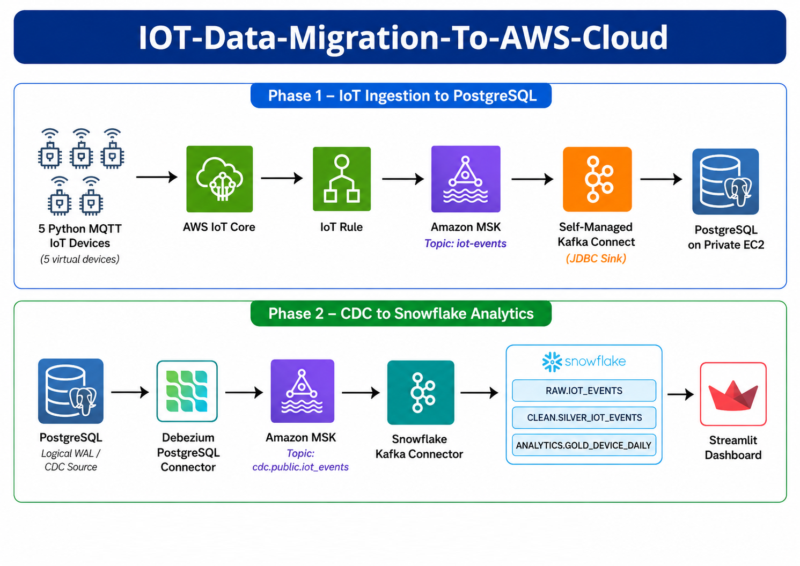

<div align="center">

<h1>📡 IOT-Data-Migration-To-AWS-Cloud</h1>

<p>
<b>End-to-end cloud data engineering pipeline using AWS IoT Core, Amazon MSK, Kafka Connect, PostgreSQL, Debezium, Snowflake, dbt, and Streamlit to ingest IoT telemetry, capture CDC events, transform Bronze data into Silver and Gold models, and serve analytics through a near-real-time dashboard.</b>
</p>

<p>


</p>

</div>

---

<p align="center">

</p>

## 📌 Project Overview

This project implements an end-to-end **IoT data ingestion, CDC migration, transformation, and analytics pipeline**.

Five Python-based virtual IoT devices publish geolocation and AQI telemetry through **MQTT** to **AWS IoT Core**. An AWS IoT rule routes the events to the Amazon MSK topic `iot-events`. A self-managed **Kafka Connect JDBC Sink** writes the events into **PostgreSQL running on a private EC2 instance**.

For Phase 2, **Debezium PostgreSQL CDC** captures INSERT, UPDATE, and DELETE changes and publishes them to `cdc.public.iot_events`. The **Snowflake Kafka Connector** loads those CDC records into the Bronze table `HACKATHON_IOT.RAW.IOT_EVENTS`. A **dbt** project transforms the data into Silver and Gold models, and a **Streamlit** dashboard queries the Gold layer for analytics.

> The Streamlit application re-queries the existing Snowflake Gold table every 30 seconds. New CDC records appear in Silver and Gold only after the dbt models are run.

---

## 🎯 Objectives

- Simulate five IoT devices in parallel
- Publish geolocation and AQI telemetry through MQTT
- Route AWS IoT Core messages into Amazon MSK
- Store IoT events in PostgreSQL through Kafka Connect JDBC Sink
- Run PostgreSQL in a private subnet with SSM-based administration
- Enable PostgreSQL logical WAL for Debezium CDC
- Capture INSERT, UPDATE, and DELETE operations through Debezium
- Load CDC records into Snowflake Bronze
- Transform Bronze data into Silver and Gold layers using dbt
- Validate dbt models through automated tests
- Build a Streamlit dashboard from the Snowflake Gold layer
- Re-query dashboard data every 30 seconds
- Provision the AWS infrastructure with AWS CDK in Python

---

## 🔄 Pipeline Workflow

```text
PHASE 1 — IoT Ingestion

5 Python Virtual IoT Devices
        │
        ▼
MQTT / AWS IoT Core
        │
        ▼
AWS IoT Rule
        │
        ▼
Amazon MSK
Topic: iot-events
        │
        ▼
Self-Managed Kafka Connect
JDBC Sink Connector
        │
        ▼
PostgreSQL on Private EC2
Table: public.iot_events
```

```text
PHASE 2 — CDC, Snowflake, dbt, and Analytics

PostgreSQL Logical WAL
        │
        ▼
Debezium PostgreSQL Connector
        │
        ▼
Amazon MSK
Topic: cdc.public.iot_events
        │
        ▼
Snowflake Kafka Connector
        │
        ▼
HACKATHON_IOT.RAW.IOT_EVENTS
Bronze
        │
        ▼
dbt CLEAN.SILVER_IOT_EVENTS
Silver
        │
        ▼
dbt ANALYTICS.GOLD_DEVICE_DAILY
Gold
        │
        ▼
Streamlit Dashboard
```

---

## 📁 Project Structure

```text
IOT-Data-Migration-To-AWS-Cloud/
│
├── cdk/
│   ├── cdk/
│   │   ├── cdk_stack.py
│   │   ├── kafka_connect_stack.py
│   │   ├── storage_stack.py
│   │   └── topic_admin_stack.py
│   ├── iot/
│   │   ├── simulator.py
│   │   ├── device-template.json
│   │   ├── manifest.example.json
│   │   └── requirements.txt
│   ├── scripts/
│   │   └── create_iot_events_topic.py
│   ├── tests/
│   ├── app.py
│   ├── cdk.json
│   ├── requirements.txt
│   └── requirements-dev.txt
│
├── kafka-connect/
│   ├── scripts/
│   │   ├── hackathon-connect-bootstrap.py
│   │   ├── hackathon-debezium-bootstrap.py
│   │   └── hackathon-source-producer-security-bootstrap.py
│   └── systemd/
│       └── hackathon-kafka-connect.service
│
├── connectors/
│   └── snowflake-sink.example.json
│
├── postgres/
│   └── init.sql
│
├── dbt/
│   ├── hackathon_iot/
│   │   ├── macros/
│   │   ├── models/
│   │   │   ├── silver/
│   │   │   └── gold/
│   │   ├── tests/
│   │   └── dbt_project.yml
│   ├── profiles/
│   │   └── profiles.yml
│   └── profiles.example.yml
│
├── streamlit/
│   ├── app.py
│   ├── requirements.txt
│   └── README.md
│
├── scripts/
│   ├── run-dbt.ps1
│   └── start-streamlit.ps1
│
├── docs/
│   ├── architecture/
│   │   ├── iot-data-migration-to-aws-cloud.png
│   │   ├── phase1.png
│   │   └── phase2.png
│   ├── screenshots/
│   └── evidence/
│
├── README.md
├── LICENSE
└── .gitignore
```

Local secrets, certificates, private keys, generated connector files, virtual environments, dbt targets, and profiles are excluded through `.gitignore`.

---

## 🧩 Core Components

### Phase 1

| Component | Purpose |
|---|---|
| Python IoT Simulator | Publishes geolocation, AQI, timestamp, and device identifiers |
| AWS IoT Core | Receives MQTT messages from virtual devices |
| AWS IoT Rule | Routes MQTT events into Amazon MSK |
| Amazon MSK | Hosts the `iot-events` Kafka topic |
| Kafka Connect JDBC Sink | Writes Kafka events into PostgreSQL |
| PostgreSQL on EC2 | Represents the private IoT source database |
| AWS Secrets Manager | Stores PostgreSQL credentials securely |
| AWS Systems Manager | Provides administration without public SSH |
| AWS CDK | Provisions the required AWS infrastructure |

### Phase 2

| Component | Purpose |
|---|---|
| Debezium PostgreSQL Connector | Captures PostgreSQL INSERT, UPDATE, and DELETE changes |
| Amazon MSK | Carries CDC records through `cdc.public.iot_events` |
| Snowflake Kafka Connector | Loads CDC records into Snowflake Bronze |
| Snowflake RAW | Bronze CDC landing layer |
| dbt CLEAN | Silver parsing, typing, validation, and AQI severity tagging |
| dbt ANALYTICS | Gold daily device aggregates |
| Streamlit | Displays Gold-layer analytics and re-queries every 30 seconds |

---

## 🧱 Snowflake Data Model

### Bronze

| Object | Description |
|---|---|
| `HACKATHON_IOT.RAW.IOT_EVENTS` | Raw Debezium CDC events loaded by the Snowflake Kafka Connector |

### Silver

| Object | Description |
|---|---|
| `HACKATHON_IOT.CLEAN.SILVER_IOT_EVENTS` | Typed and validated CDC events with source timestamps, operation names, and AQI severity tags |

### Gold

| Object | Description |
|---|---|
| `HACKATHON_IOT.ANALYTICS.GOLD_DEVICE_DAILY` | Daily CDC activity aggregates grouped by device and event date |

Gold represents historical CDC activity and dashboard-ready aggregates. It is not a direct current-state snapshot of every physical device.

---

## 📊 Streamlit Dashboard

The dashboard queries:

```text
HACKATHON_IOT.ANALYTICS.GOLD_DEVICE_DAILY
```

It provides:

- Device activity map
- AQI time-series trend
- Top-N devices chart
- Device count
- Total CDC event count
- Weighted average AQI
- Peak AQI
- Current Islamabad dashboard clock
- Newest Gold-layer event timestamp
- Gold-layer detail table
- Device and date filters
- Automatic Snowflake re-query every 30 seconds
- Responsive layout for desktop, laptop, tablet, and mobile screens

> A 30-second Streamlit refresh does not create new IoT events and does not run dbt. It only queries the latest Gold table currently available in Snowflake.

---

## ✅ Verified Results

| Validation | Result |
|---|---|
| Simulated devices | 5 |
| IoT events delivered to PostgreSQL | 15 |
| PostgreSQL baseline rows after CDC test | 15 |
| Debezium CDC events | 3 |
| CDC operation sequence | `c`, `u`, `d` |
| Snowflake Bronze records | 3 |
| dbt models | 2/2 passed |
| dbt tests | 13/13 passed |
| dbt documentation | Generated successfully |
| Bronze → Silver → Gold lineage | Validated |
| Streamlit Gold-layer events | 3 |
| Streamlit Snowflake re-query | 30 seconds |

---

## ☁️ AWS Services Used

| AWS Service | Purpose |
|---|---|
| AWS IoT Core | MQTT ingestion |
| Amazon MSK | Kafka event transport |
| Amazon EC2 | PostgreSQL and self-managed Kafka Connect runtime |
| AWS Secrets Manager | PostgreSQL and connector secrets |
| AWS Systems Manager | Secure administration |
| Amazon VPC | Private networking and subnet isolation |
| AWS IAM | Roles and permissions |
| AWS CDK | Infrastructure as code |

---

## 🛠️ Technologies Used

| Technology | Purpose |
|---|---|
| Python | IoT simulation, CDK, bootstrap scripts, and Streamlit |
| AWS CDK | Infrastructure provisioning |
| MQTT | IoT messaging protocol |
| Apache Kafka | Event streaming |
| Kafka Connect | JDBC Sink and connector runtime |
| Debezium | PostgreSQL change data capture |
| PostgreSQL | IoT source database |
| Snowflake | Bronze, Silver, and Gold warehouse layers |
| dbt | SQL transformations, tests, documentation, and lineage |
| Streamlit | Analytics dashboard |
| Altair | Dashboard charts |
| PyDeck | Device activity map |
| SQL | Database schema and transformations |
| PowerShell | Local setup and launch scripts |

---

## 🚀 Local Setup and Execution

### Prerequisites

- Windows PowerShell
- Python 3.13 or another version supported by the listed packages
- AWS CLI
- Git
- Access to the already deployed AWS resources
- Valid AWS profile named `hackathon`
- Local AWS IoT certificates and `AmazonRootCA1.pem`
- Snowflake account identifier and service username
- Encrypted Snowflake private key and its passphrase

### 1. Clone the repository

```powershell
git clone https://github.com/CodeByMan/IOT-Data-Migration-To-AWS-Cloud.git
Set-Location ".\IOT-Data-Migration-To-AWS-Cloud"
$Root = (Get-Location).Path
```

When running from the existing local directory instead:

```powershell
$Root = "C:\Users\Work\Downloads\IOT-Data-Migration-To-AWS-Cloud"
Set-Location $Root
```

### 2. Recreate the Python virtual environment

```powershell
python --version

python -m venv "$Root\dbt\.venv"

if (-not (Test-Path "$Root\dbt\.venv\Scripts\python.exe")) {
    throw "Virtual environment creation failed."
}

& "$Root\dbt\.venv\Scripts\python.exe" -m pip install --upgrade pip
```

### 3. Install dbt, Streamlit, Snowflake, and IoT dependencies

```powershell
& "$Root\dbt\.venv\Scripts\python.exe" `
    -m pip install `
    dbt-snowflake `
    -r "$Root\streamlit\requirements.txt" `
    -r "$Root\cdk\iot\requirements.txt"
```

Verify:

```powershell
& "$Root\dbt\.venv\Scripts\python.exe" --version
& "$Root\dbt\.venv\Scripts\dbt.exe" --version
& "$Root\dbt\.venv\Scripts\streamlit.exe" --version

& "$Root\dbt\.venv\Scripts\python.exe" -c `
"import altair, pandas, pydeck, snowflake.connector, streamlit; print('LOCAL_ENVIRONMENT=PASS')"
```

### 4. Configure local-only files

Create the real local dbt profile from:

```text
dbt/profiles.example.yml
```

Save the configured file as:

```text
dbt/profiles/profiles.yml
```

Store the encrypted Snowflake private key locally at:

```text
cdk/snowflake-keys/rsa_key.p8
```

The following must never be committed:

```text
dbt/profiles/profiles.yml
cdk/snowflake-keys/
cdk/iot/certificates/
cdk/cdk.context.json
cdk/connector.json
dbt/hackathon_iot/target/
dbt/.venv/
```

### 5. Prepare the local IoT certificate manifest

The repository provides:

```text
cdk/iot/manifest.example.json
```

Copy it into the ignored certificates directory:

```powershell
New-Item `
    -ItemType Directory `
    -Path "$Root\cdk\iot\certificates" `
    -Force |
    Out-Null

Copy-Item `
    "$Root\cdk\iot\manifest.example.json" `
    "$Root\cdk\iot\certificates\manifest.json" `
    -Force
```

Place these local-only files inside `cdk/iot/certificates/`:

```text
AmazonRootCA1.pem
hackathon-iot-device-01-certificate.pem.crt
hackathon-iot-device-01-private.pem.key
hackathon-iot-device-02-certificate.pem.crt
hackathon-iot-device-02-private.pem.key
hackathon-iot-device-03-certificate.pem.crt
hackathon-iot-device-03-private.pem.key
hackathon-iot-device-04-certificate.pem.crt
hackathon-iot-device-04-private.pem.key
hackathon-iot-device-05-certificate.pem.crt
hackathon-iot-device-05-private.pem.key
manifest.json
```

### 6. Authenticate AWS

```powershell
aws sts get-caller-identity `
    --profile hackathon
```

If the session has expired:

```powershell
aws login `
    --profile hackathon
```

Run the identity check again after authentication.

### 7. Retrieve the AWS IoT endpoint

```powershell
$IoTEndpoint = aws iot describe-endpoint `
    --endpoint-type iot:Data-ATS `
    --region us-east-1 `
    --profile hackathon `
    --query endpointAddress `
    --output text

if ([string]::IsNullOrWhiteSpace($IoTEndpoint)) {
    throw "AWS IoT endpoint retrieval failed."
}

Write-Host "IOT_ENDPOINT=$IoTEndpoint"
```

### 8. Run the five-device IoT simulator

```powershell
& "$Root\dbt\.venv\Scripts\python.exe" `
    "$Root\cdk\iot\simulator.py" `
    --endpoint $IoTEndpoint `
    --messages-per-device 3 `
    --interval-seconds 1
```

Expected final markers:

```text
SIMULATED_DEVICE_COUNT=5
MESSAGES_PER_DEVICE=3
TOTAL_MESSAGES=15
PARALLEL_EXECUTION=PASS
IOT_CORE_MQTT_PUBLISH=PASS
```

### 9. Run dbt after CDC data reaches Snowflake Raw

```powershell
Set-Location $Root

powershell -ExecutionPolicy Bypass `
    -File "$Root\scripts\run-dbt.ps1"
```

The script runs:

```text
dbt debug
dbt run
dbt test
dbt docs generate
```

Expected dbt results:

```text
2 models passed
13 tests passed
```

### 10. Start Streamlit

```powershell
Set-Location $Root

powershell -ExecutionPolicy Bypass `
    -File "$Root\scripts\start-streamlit.ps1"
```

Open:

```powershell
Start-Process "http://127.0.0.1:8501"
```

Check application health from another PowerShell window:

```powershell
$response = Invoke-WebRequest `
    -Uri "http://127.0.0.1:8501/_stcore/health" `
    -UseBasicParsing

Write-Host "HTTP_STATUS=$($response.StatusCode)"
Write-Host "STREAMLIT_HEALTH=$($response.Content)"
```

Expected:

```text
HTTP_STATUS=200
STREAMLIT_HEALTH=ok
```

Stop Streamlit with:

```text
Ctrl+C
```

---

## ☁️ AWS Infrastructure

The infrastructure used by the verified solution is already deployed.

Do not run `cdk deploy` merely to run dbt or Streamlit. CDK deployment is required only when recreating or intentionally changing AWS resources.

The verified Kafka Connect runtime is self-managed on the Bastion EC2. The managed MSK Connect implementation remains in the repository as infrastructure code, but it was not the successful runtime because the deployment was blocked by AWS authorization.

---

## 🧪 Validation Queries

### PostgreSQL

```sql
SELECT COUNT(*)
FROM public.iot_events;
```

```sql
SELECT *
FROM public.iot_events
ORDER BY event_time DESC;
```

### Snowflake Bronze

```sql
SELECT COUNT(*) AS RECORD_COUNT
FROM HACKATHON_IOT.RAW.IOT_EVENTS;
```

### Snowflake Silver

```sql
SELECT
    COUNT(*) AS SILVER_RECORD_COUNT,
    COUNT_IF(DEVICE_ID IS NULL) AS NULL_DEVICE_IDS,
    COUNT_IF(EVENT_TIMESTAMP IS NULL) AS NULL_TIMESTAMPS,
    COUNT_IF(SEVERITY_TAG IS NULL) AS NULL_SEVERITY_TAGS
FROM HACKATHON_IOT.CLEAN.SILVER_IOT_EVENTS;
```

### Snowflake Gold

```sql
SELECT
    COUNT(*) AS GOLD_RECORD_COUNT,
    SUM(TOTAL_CDC_EVENTS) AS GOLD_TOTAL_CDC_EVENTS,
    MAX(LAST_EVENT_TIMESTAMP) AS LATEST_GOLD_EVENT
FROM HACKATHON_IOT.ANALYTICS.GOLD_DEVICE_DAILY;
```

---

## 📌 Key Learning Outcomes

- IoT ingestion through AWS IoT Core and MQTT
- Real-time event streaming with Amazon MSK
- Kafka Connect JDBC Sink integration
- PostgreSQL logical WAL configuration
- Change data capture with Debezium
- Snowflake Kafka Connector ingestion
- Bronze, Silver, and Gold data modeling
- dbt transformations, tests, documentation, and lineage
- Streamlit analytics from Snowflake Gold
- Secure configuration with IAM, Secrets Manager, VPC, and SSM
- Infrastructure as code with AWS CDK

---

## 👤 Author

**Muhammad Ali Nawaz**  
Cloud Data Engineer

---

## 📄 License

This project is licensed under the [MIT License](LICENSE).

---

<p align="center">
<b>⭐ If you found this project useful, consider giving it a star!</b>
</p>
